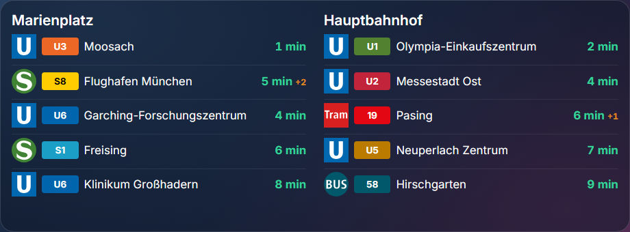

# MVG Abfahrten · MVG Departures

**[Deutsch](#deutsch) · [English](#english)** · Plugin für / for [Home Screens](https://github.com/home-screens/home-screens) · v0.6.0

<p align="center"></p>

## Deutsch

Zeigt die **nächsten Abfahrten der Münchner Verkehrsgesellschaft (MVG)** live auf deinem Home-Screens-Display – U-Bahn, S-Bahn, Tram und Bus, mit Echtzeit-Verspätungen und den originalen MVG-Symbolen.

### Was kann das Plugin?

- Bis zu **zwei Haltestellen** im selben Modul – untereinander oder nebeneinander
- **Verkehrsmittel-Filter** (nur U- und S-Bahn, nur Bus, …)
- **Richtungs-Filter** („nur stadteinwärts“ über Zielhaltestellen)
- Countdown in Minuten, Verspätungen, Ausfälle

### Installation – Schritt für Schritt

**Voraussetzung:** Du hast Home Screens bereits laufen (Server erreichbar im Browser).

1. Öffne den **Editor** deines Home-Screens-Servers im Browser an einem Computer (nicht am Handy; er braucht mindestens 768 Pixel Breite). Die Adresse ist meist `http://<Adresse-deines-Servers>:3000/editor`.
2. Klicke oben in der Leiste auf **Plugins** (neben „Einstellungen“ und „Vorschau“).
3. Klicke auf **Aus URL installieren …**.
4. Füge im Feld **Tarball-URL** diesen Link ein und klicke auf **Installieren**:

   ```
   https://github.com/Gyrosguenter/home-screens-plugin-mvg/releases/latest/download/mvg-departures.tar.gz
   ```

   Home Screens weist darauf hin, dass das Plugin „nicht vom Home-Screens-Team geprüft“ ist. Das ist normal, denn es stammt nicht aus dem Marktplatz. Du siehst eine Übersicht, was das Plugin darf.
5. Warte, bis die Installation fertig ist, und klicke auf **Fertig**. Falls das Modul nicht sofort in der Liste auftaucht, lade die Seite neu (F5).
6. Ziehe das Modul auf den Bildschirm: Links in der Liste **MODULE** (Hinweis „Auf den Bildschirm ziehen“) findest du unter **REISE** das Modul **MVG Abfahrten** (mit der Markierung „Plug-in“). Ziehe es auf deinen Bildschirm und passe Größe und Position an.
7. Klicke das Modul an: rechts erscheinen die **Einstellungen**. Der Editor **speichert automatisch**, einen Speichern-Knopf gibt es nicht.

### Einstellungen

| Einstellung | Bedeutung |
|---|---|
| Haltestelle | Name der Haltestelle wie auf mvg.de, z. B. `Marienplatz` oder `Hauptbahnhof`. Bei mehreren Treffern wird der erste verwendet. |
| Anzeigename | Optionaler Titel statt des Haltestellennamens, z. B. `Zuhause · stadteinwärts`. |
| Verkehrsmittel | Kommagetrennt: `U`, `S`, `Tram`, `Bus`. Leer = alle. |
| Richtung (Ziel enthält) | Kommagetrennt, z. B. `Marienplatz, Münchner Freiheit`. Es erscheinen nur Abfahrten, deren Ziel einen dieser Begriffe enthält. Leer = alle Richtungen. |
| Haltestelle 2 (und deren Filter) | Optional eine zweite Haltestelle mit eigenen Filtern. Leer = nur eine Haltestelle. |
| Haltestellen nebeneinander | Zwei Haltestellen nebeneinander statt untereinander (für breite, niedrige Fenster). |
| Anzahl Abfahrten je Haltestelle | 1–20, Standard 8. |
| Aktualisierung (ms) | Wie oft neue Daten geholt werden (mindestens 15 000 = 15 Sekunden). |

### Aktualisieren

Wiederhole einfach die Installation mit **demselben Link** (Schritte 2–4). Er zeigt immer auf die neueste Version; deine Einstellungen bleiben erhalten.

### Hilfe bei Problemen

- **Haltestelle wird nicht gefunden?** Probier einen kürzeren Namen (z. B. `Clanze` statt `Johann-Clanze-Straße`) oder den Namen genau wie auf mvg.de.
- **„Stadteinwärts“ gibt es nicht als Feld.** Trage stattdessen die Endhaltestellen ein, in die du willst, z. B. `Marienplatz, Münchner Freiheit, Hauptbahnhof`.
- **Zu wenige Einträge mit Filter?** Erhöhe „Anzahl Abfahrten“; die MVG liefert die Liste vor dem Filter.
- **Installation schlägt fehl?** Dein Home-Screens-Server muss auf `github.com` zugreifen können (Internet). Prüfe, ob der Link vollständig kopiert wurde.
- **Modul bleibt leer nach dem Ziehen?** Seite neu laden (F5). Ein paar Sekunden warten, manche Module laden Daten erst nach dem Einfügen.

### Datenschutz und Hinweise

Das Modul fragt über den Server-Proxy deines Home-Screens-Servers `www.mvg.de` ab (nur Haltestellennamen und Abfahrten). Es werden keine persönlichen Daten gesendet. **Inoffiziell:** Das Plugin nutzt die Web-Schnittstelle von mvg.de, die nicht öffentlich dokumentiert ist und sich ändern kann. Es ist kein Angebot der MVG.

---

## English

Shows the **next departures of Munich public transport (MVG)** live on your Home Screens display – U-Bahn, S-Bahn, tram and bus, with real-time delays and the original MVG pictograms.

### What does it do?

- Up to **two stops** in one module – stacked or side by side
- **Mode filter** (only U-Bahn and S-Bahn, only bus, …)
- **Direction filter** ("towards the city centre" via destination names)
- Minute countdown, delays and cancellations

### Installation – step by step

**Prerequisite:** Home Screens is already running (server reachable in the browser).

1. Open the **editor** of your Home Screens server in a browser on a computer (not a phone; it needs at least 768 pixels width). The address is usually `http://<address-of-your-server>:3000/editor`.
2. Click **Plugins** in the top bar (next to "Settings" and "Preview").
3. Click **Install from URL…**.
4. Paste this link into the **Tarball URL** field and click **Install**:

   ```
   https://github.com/Gyrosguenter/home-screens-plugin-mvg/releases/latest/download/mvg-departures.tar.gz
   ```

   Home Screens warns that the plugin "has not been reviewed by the Home Screens team". That is normal because it does not come from the marketplace. You will see an overview of what the plugin may do.
5. Wait until the installation has finished and click **Done**. If the module does not show up in the list immediately, reload the page (F5).
6. Drag the module onto the screen: in the **MODULES** list on the left ("Drag onto the screen") find **MVG Abfahrten** under **TRAVEL** (marked "Plugin"). Drag it onto your screen and adjust size and position.
7. Click the module: the **settings** appear on the right. The editor **saves automatically**; there is no save button.

### Settings

| Setting | Meaning |
|---|---|
| Stop | Stop name as on mvg.de, e.g. `Marienplatz` or `Hauptbahnhof`. If several match, the first is used. |
| Display name | Optional title instead of the stop name, e.g. `Home · towards city`. |
| Modes | Comma-separated: `U`, `S`, `Tram`, `Bus`. Empty = all. |
| Direction (destination contains) | Comma-separated, e.g. `Marienplatz, Münchner Freiheit`. Only departures whose destination contains one of these words are shown. Empty = all directions. |
| Stop 2 (and its filters) | Optional second stop with its own filters. Empty = one stop only. |
| Stops side by side | Show two stops next to each other instead of stacked (for wide, low windows). |
| Departures per stop | 1–20, default 8. |
| Refresh (ms) | How often new data is fetched (minimum 15,000 = 15 seconds). |

### Updating

Simply repeat the installation with the **same link** (steps 2–4). It always points to the latest version; your settings are kept.

### Troubleshooting

- **Stop not found?** Try a shorter name (e.g. `Clanze` instead of `Johann-Clanze-Straße`) or the exact name from mvg.de.
- **There is no "inbound" field.** Enter the terminal stops you want instead, e.g. `Marienplatz, Münchner Freiheit, Hauptbahnhof`.
- **Too few rows with a filter?** Raise "Departures per stop"; MVG delivers the list before the filter is applied.
- **Installation fails?** Your Home Screens server must be able to reach `github.com` (internet). Check that the link was copied completely.
- **Module stays empty after dragging?** Reload the page (F5). Wait a few seconds; some modules fetch data only after being added.

### Privacy and notes

The module queries `www.mvg.de` through your Home Screens server's proxy (stop names and departures only). No personal data is sent. **Unofficial:** the plugin uses the web interface of mvg.de, which is not publicly documented and may change. It is not an offering of MVG.

---

## Technik / Technical notes

- **ID / Manifest:** `mvg-departures` – Version 0.6.0, License MIT
- Bauen / Build: `npm install && npm run build && npm test`
- Release-Archiv für die Installation / Release archive used for installation: `mvg-departures.tar.gz` (enthält / contains `mvg-departures/manifest.json` + `mvg-departures/dist/bundle.js`)
- Teil eines privaten Heim-Projekts (Magic-Mirror-Ersatz); als eigenes öffentliches Repo geführt, damit die Installations-URL ohne Anmeldung erreichbar ist / Part of a private home project (Magic Mirror replacement); kept as its own public repo so the install URL works without login.
- Dieses Plugin ist ein inoffizielles Community-Plugin und steht in keiner Verbindung zum Home-Screens-Team / This is an unofficial community plugin and is not affiliated with the Home Screens team.

MIT
